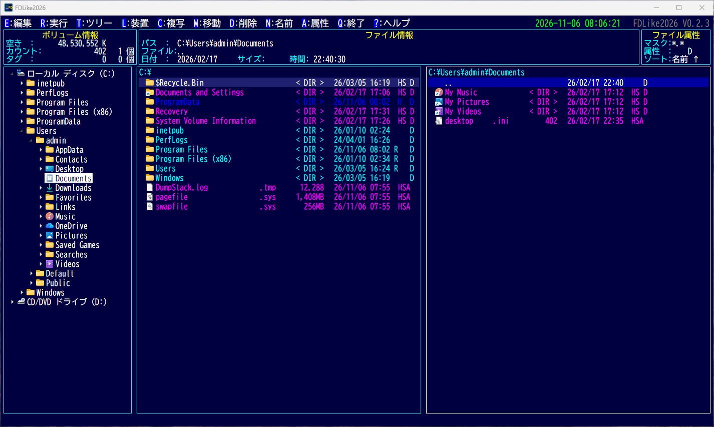
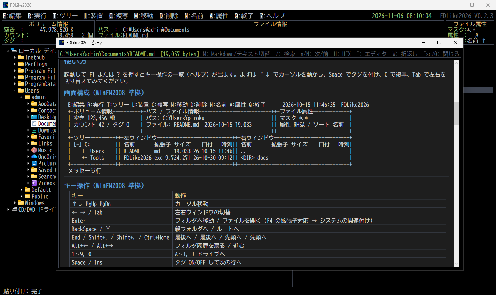

# FDLike2026

**FD / FILMTN / WinFM2008 の操作体系を受け継いだ、Windows 11 向けのキーボード中心 2 画面ファイラー**

> FDLike2026 is a keyboard-driven, two-pane file manager for Windows 11, written in C# / WPF (.NET 8).
> It faithfully follows the key bindings, screen layout and classic color scheme of WinFM2008, a long-lived
> Windows filer in the lineage of FD, the legendary MS-DOS file manager from Japan. The UI is Japanese only.
> Download a zip from the Releases page, extract it and run `FDLike2026.exe` (.NET 8 Desktop Runtime required).
> Licensed under MIT. See [Acknowledgements](#謝辞--acknowledgements) below.



MS-DOS 時代の FD、そして Windows で長く使われた WinFM2008。「キーボードだけで気持ちよくファイルを扱える」あの操作感を Windows 11 でも使い続けたくて作った、ゼロから書き起こした独立したソフトです。WinFM2008 のコードは含まず、作者とも無関係です（詳しくは[謝辞](#謝辞--acknowledgements)）。

## 特徴

- **WinFM2008 互換のキー配置と画面構成**。ファンクション行、ボリューム情報 / パス / 属性の情報ボックス、ツリー＋左右ウィンドウ、メッセージ行。配色「Classic」は紺地にシアン枠・黄色数字。
- **1 キーで操作**: C 複写 / M 移動 / D 削除 / N 名前 / A 属性 / E 編集 / R 実行 / V ビューア / T ツリー / J JumpFolder / F 検索 / Shift+F grep / P・U zip 圧縮・解凍 ほか（[キー操作](#キー操作winfm2008-準拠)）。
- **ビューア（V）**: テキスト / HEX、Markdown 整形表示、ソースの色分け＋行番号、画像（GIF アニメ対応）、CSV / TSV の表、PDF / HTML（WebView2）、Word / Excel / PowerPoint の抽出テキスト。

  
- **grep（Shift+F）**: 文字列検索の結果から移動・該当行をビューア / エディタで開く・ヒットした全ファイルにタグ。**docx / xlsx / pptx / PDF の中身も検索**（旧形式 .doc / .xls / .ppt / .rtf / .msg などは Office の IFilter 経由）。
- **Windows との連携**: エクスプローラーとのドラッグ＆ドロップ / コピー＆貼り付け、右クリックから Windows のシェルメニュー（7-Zip・送る・プロパティなど）、ごみ箱、Enter はシステムの関連付けで開く、Teams などから貼り付けた `\\server\share` や `file://` のパスへそのまま移動。
- **カスタマイズ（F10）**: 配色 12 種（Classic / DOS 16色 / ダーク / ライト / VS Code 系 6 種 / ユニバーサル 2 種）と約 40 項目の色指定、フォント、表示モード、エディタ・比較ツールの指定。F2 のコマンドマクロ、F4 の拡張子対応。
- **Windows 11 対応**: 長いパス（260 文字超）、Per-Monitor V2 の高 DPI、Unicode ファイル名、BIZ UDゴシック。
- インストーラー不要の zip 配布。レジストリには書きません。アンインストールはフォルダ削除。

## 動作環境

- Windows 11（Windows 10 でも動作します）、x64
- [.NET 8 Desktop Runtime](https://dotnet.microsoft.com/ja-jp/download/dotnet/8.0)（x64）。入っていないと起動時にインストールの案内が出ます。
- Microsoft Edge WebView2 ランタイム（PDF / HTML の表示に使用。Windows 11 には最初から入っています。無い場合は [Evergreen ブートストラップ](https://developer.microsoft.com/ja-jp/microsoft-edge/webview2/) を）

## インストール

1. [Releases](../../releases) から `FDLike2026-v<版>-win-x64.zip` をダウンロードし、好きな場所に展開します（例: `C:\Tools\FDLike2026`）。Program Files 配下は書き込み権限の都合で避けてください。
2. `FDLike2026.exe` を起動します。ショートカットをデスクトップやタスクバーに作ると便利です。
3. 初回起動時に SmartScreen の「Windows によって PC が保護されました」が出た場合は「詳細情報」→「実行」を押してください（コード署名をしていないため表示されます）。

アンインストールは展開したフォルダを削除するだけです。設定は `%APPDATA%\FDLike2026\settings.json`、エラーログは同じフォルダの `error.log` にあるので、完全に消したいときはこのフォルダも削除してください。

## 使い方

起動して **F1** または **?** を押すとキー操作の一覧（ヘルプ）が出ます。まずは ↑↓ でカーソルを動かし、Space でタグを付け、C で複写、Tab で左右を切り替えてみてください。

### 画面構成（WinFM2008 準拠）

上からファンクション行（Edit / Run / Tree …）、ボリューム情報・パス / ファイル情報・ファイル属性の 3 つの情報ボックス、ツリー＋左右ウィンドウ、最下行がメッセージ行です（図は等幅表示のため英語表記。実際の画面は上のスクリーンショットの通り日本語です）。

```
E:Edit R:Run T:Tree L:Drive C:Copy M:Move D:Delete N:Rename A:Attr Q:Quit     2026-10-15 11:46:35  FDLike2026
+-Volume-----------------++-Path / File------------------------------------++-Attributes---------------+
| Free  123,456 MB       || Path: C:\Users\piroku                          || Mask *.*                 |
| Count 42 / Tag 0       || File: README.md  2026-10-15 19,033             || Attr RHSA / Sort Name    |
+------------------------++------------------------------------------------++--------------------------+
+-Tree-----------++-Left window-----------------------------++-Right window----------------------------+
| [-] C:         || Name       Ext  Size     Date     Time  || Name       Ext  Size     Date     Time  |
|    +- Users    || README     md      19,033 26-10-15 11:46|| ..                                      |
|    +- Tools    || FDLike2026 exe  9,724,271 26-10-30 09:12|| <DIR> docs                              |
+----------------++-----------------------------------------++-----------------------------------------+
Message line
```

### キー操作（WinFM2008 準拠）

| キー | 動作 |
|---|---|
| ↑↓ PgUp PgDn | カーソル移動 |
| ← → / Tab | 左右ウィンドウの切替 |
| Enter | フォルダへ移動 / ファイルを開く（F4 の拡張子対応 → システムの関連付け） |
| BackSpace / ￥ | 親フォルダへ / ルートへ |
| End / Shift+. / Shift+, / Ctrl+Home | 最後へ / 最後へ / 先頭へ / 先頭へ |
| Alt+← / Alt+→ | フォルダ履歴を戻る / 進む |
| 1～9, 0 | A～I, J ドライブへ |
| Space / Ins | タグ ON/OFF して次の行へ |
| Home / Shift+Home | 全ファイルにタグ・解除（トグル） / フォルダも含めて |
| Ctrl+A / Ctrl+W / Ctrl+Z / Ctrl+K | 全選択 / ファイルのみ / タグ反転 / ワイルドカードで選択 |
| **A** | 属性の変更（R/H/S/A） |
| **B** | カレントで PowerShell を開く |
| **C** / **M** | 複写 / 移動（WinFM2008 準拠のダイアログ: 宛先の履歴・ジャンプ・参照、同名時の方法、更新のみ、フィルタ、名前を変えて複写、進捗・中止） |
| **D** / Del | 削除（ごみ箱）　Ctrl+Del で完全削除 |
| **E** | 編集（F10 で設定したエディタ。`..` や空の所では新規ファイルを作って開く） |
| **F** | ファイルの検索（結果の一覧を右クリックで Windows のメニュー、Delete で削除） |
| **H** | パスを入力してフォルダ変更 |
| **J** | JumpFolder（F1～F12 / A～Z の登録フォルダへ。上のパス欄に `\\server\share` / `file://…` / `"…"` 付き / ファイルのパスを貼り付けて Enter で、登録せずに 1 回だけ移動。Ctrl+V で即移動） |
| **K** | フォルダの新規作成 |
| **L** | 装置（ドライブ）選択 |
| **N** | 名前の変更 |
| **O** | 反対側ウィンドウを同じフォルダにする |
| **P** / **U** | zip に圧縮 / zip を解凍（進捗表示・中止可、オブジェクト単位の書庫化、書庫名フォルダへの展開） |
| **Q** | 終了 |
| **R** | 実行（WinFM と同じく「コマンドの実行」画面を開いてから実行。アプリケーション名にはカーソル位置のフルパス、`..` や何もない所ならカレントフォルダが入る） |
| **S** | ソート（名前 / 拡張子 / サイズ / 日付） |
| **T** | ツリーへ移る（WinFMTree 相当: ↑↓←→ Space Enter Esc、Shift+英字で頭文字ジャンプ、K でサブフォルダ作成） |
| F6 | ツリーの表示 / 非表示 |
| **V** | ビューア（テキスト / HEX / Markdown / ソース / 画像 / CSV / PDF / HTML / Office 文書 / zip の中身一覧。`/` 検索 n/N、W 折り返し、M 切替） |
| **X** | コマンドの実行（WinFM2008 と同じダイアログ: アプリケーション名・コマンドライン・DOS コマンド・別ユーザーで実行。$ マクロ可） |
| **Y** | マスク（例 `*.log`） |
| **Z** | エクスプローラーで表示 |
| Shift+D | 隠し / システム属性の表示切替 |
| Shift+G / Ctrl+G | ごみ箱を空にする / ごみ箱を開く |
| Shift+I | イニシャルサーチ（頭文字でジャンプ） |
| Shift+N | 名前の一括変換（固定文字列＋連番、既存名流用、先頭/末尾/両方、拡張子の変更、プレビュー付き） |
| Shift+P | プロパティ |
| Shift+S | 最小化 |
| Shift+W | 比較（WinMerge など。タグ 2 件ならその 2 つ、カーソルがファイルなら反対ペインの同名ファイル、フォルダなら左右のフォルダ） |
| Shift+F | 文字列の検索 (grep)。Word / Excel / PowerPoint / PDF の中身も検索。結果から 移動 / V ビューアで該当行 / E エディタで該当行 / T ヒットした全ファイルにタグ / Ctrl+C で結果一覧をコピー |
| Ctrl+C / Ctrl+X / Ctrl+V | コピー / 切り取り / 貼り付け（エクスプローラーと相互運用。エディタに貼るとファイル名の一覧、WinFM2008 と同じ） |
| Ctrl+B / Ctrl+Shift+B | フルパス / ファイル名（パスなし）をクリップボードへ |
| Ctrl+D | サブフォルダのサイズ |
| Ctrl+H | 最近開いたフォルダ |
| Ctrl+I | アイコンの表示 / 非表示（一覧・ツリー。エクスプローラーと同じシェルアイコン） |
| Ctrl+M | ミラーコピー（robocopy /MIR。フィルタ、実行前の一覧確認、手順の保存） |
| Ctrl+N | 新規ファイルの作成 |
| Ctrl+T | タイムスタンプの変更 |
| Ctrl+U | ファイル名の大文字・小文字変換 |
| Ctrl+Shift+C | ドライブ選択（マイコンピュータ相当） |
| Shift+1～5 | 表示モードの切り替え（F10 › リスト: ファイル名の幅・拡張子分離・日付/時刻・サイズ・属性・右ウィンドウの表示） |
| Shift+F6 | 右ウィンドウの表示 / 非表示 |
| F1 / ? | ヘルプ |
| F2 | コマンドマクロ（A～Z / 1～9 に「タイトル,コマンド」を登録して 1 キー実行。`$P $C $X $T $F $O $Q $R $Y… $S…` 置換。既定で V/F = VS Code、W/M = WinMerge） |
| F3 | DOS シェル（Windows Terminal → cmd） |
| F4 | 拡張子の対応（Enter で開くプログラムを拡張子ごとに指定。システムの関連付けより優先） |
| F5 | 再読込 |
| F10 | カスタマイズ |

### マウス操作

- 一覧の行は クリックでカーソル移動、**Shift+クリックでカーソル行からその行までをまとめてタグ**（WinFM2008 と同じ）、Ctrl+クリックでその行のタグを付け外し。
- 一覧の行をドラッグすると、Teams・メール・エクスプローラーなど他のアプリへファイルを渡せます（タグ付きの行を掴むとタグ全部）。
- エクスプローラーなどからファイルをウィンドウへドロップすると複写（Shift を押しながらで移動）。フォルダ行やツリーのフォルダの上に落とすとそのフォルダが宛先になります。
- 一覧の右クリックメニュー: 開く / 編集 / ビューア / 複写 / 移動 / 名前の変更 / 削除 / 完全削除 / 属性 / 新規フォルダ / エクスプローラーで開く / PowerShell / パスをコピー / 再読込 / **Windows のメニュー**（エクスプローラーと同じシェルメニュー。Shift を押しながら選ぶと拡張項目も表示）。
- ツリー｜左一覧、左一覧｜右一覧 の境界をドラッグして幅を変更できます。

### カスタマイズ（F10）

WinFM2008 の「カスタマイズ」相当の画面です。

- **デザイン**: 配色は名前付きで保存・切替（組み込み 12 種: Classic / DOS 16色 / ダーク / ライト / VS Code Dark+ / Light+ / Dark Modern / Light Modern / Monokai / Abyss / ユニバーサル (ダーク) / (ライト)）。「指定する部分」の一覧（ファイル・フォルダ・隠し・システム・タグ・カーソル・ファンクション・インフォメーション・フレーム・背景・ツリー・Markdown など約 40 項目）を選んで RGB スライダー、#RRGGBB、または色の選択ダイアログで指定。フォントは情報ボックス / ファイル一覧 / ツリー / その他の 4 領域で個別に指定、行間とタグマーク（矢印 / *印）も変更可。変更は即座に画面へ反映されます。
- **リスト**: 表示モード 1～5 の列構成、名前列の幅（自動）、git 状態列。
- **操作**: エディタと行指定の書式（`$F` `$L`。例: VS Code → `-g "$F:$L"`、サクラエディタ → `-Y=$L "$F"`、秀丸 → `/j$L "$F"`）、比較ツール、ごみ箱、隠しファイル、grep の既定。

## ビルド

Visual Studio 2022 または .NET 8 SDK。

```
dotnet build
dotnet run
```

配布用 zip（単一 EXE ＋ README / CHANGELOG / LICENSE / THIRD-PARTY-NOTICES / はじめにお読みください.txt）:

```
.\tools\publish.ps1                 # publish\FDLike2026-v<版>-win-x64.zip（約 3 MB。.NET 8 Desktop Runtime は利用者側で導入）
.\tools\publish.ps1 -SelfContained  # ランタイム同梱版（.NET が無い PC でも動く。150 MB 前後）
```

`tools\build_all.ps1` で Debug / Release の両方をビルド、`FDLike2026.exe --extract <文書> <出力txt>` で Office / PDF のテキスト抽出結果を確認できます。

### 構成

```
FDLike2026/
  App.xaml(.cs)         配色・共通スタイル、IME 制御、エラーログ
  MainWindow.xaml(.cs)  メイン画面、キーマップとコマンド
  Models/               一覧 1 行（FileEntry）
  ViewModels/           左右ウィンドウの状態（Pane）、全体（Main）、ツリー（TreeNode）
  Services/             ファイル操作・複写エンジン・zip・grep / 文書テキスト抽出・シェル連携（コンテキストメニュー、貼り付け、アイコン）・設定・配色・マクロ展開・パス整形
  Views/                各ダイアログ（複写/移動、実行、検索、grep、JumpFolder、マクロ、ミラー、一括リネーム …）、ビューア、ヘルプ
  tools/                build_all.ps1 / publish.ps1 / commit.ps1 / dist-readme.txt
  docs/                 WinFM2008 機能対応表、アイコン
```

利用ライブラリ: [Markdig](https://github.com/xoofx/markdig)（Markdown）、[WpfAnimatedGif](https://github.com/XamlAnimatedGif/WpfAnimatedGif)（GIF）、[Microsoft.Web.WebView2](https://developer.microsoft.com/microsoft-edge/webview2/)（PDF / HTML）、[Emoji.Wpf](https://github.com/samhocevar/emoji.wpf)（カラー絵文字）、[PdfPig](https://github.com/UglyToad/PdfPig)（PDF テキスト抽出）。詳細は [THIRD-PARTY-NOTICES.md](THIRD-PARTY-NOTICES.md)。

## 既知の制限

- UI とヘルプは日本語のみです。
- コード署名をしていないため、初回起動時に SmartScreen の警告が出ます。
- 書庫は zip のみ対応（7z / rar などは右クリック「Windows のメニュー」から 7-Zip 等で）。
- WinFM2008 のマルチカラム一覧（1 ディレクトリを複数列で表示）は未実装です。機能ごとの対応状況は [docs/WinFM2008機能対応表.md](docs/WinFM2008機能対応表.md) を参照してください。

## 不具合報告・要望

[Issues](../../issues) へお願いします。起動エラーや操作中のエラーは `%APPDATA%\FDLike2026\error.log` に記録されるので、再現手順と一緒に添えていただけると助かります。変更履歴は [CHANGELOG.md](CHANGELOG.md) にあります。

FDLike2026 は WinFM2008 の作者とは無関係の独立したソフトです。互換性についての問い合わせも、WinFM2008 の作者ではなく本リポジトリへお願いします。

## ライセンス

[MIT License](LICENSE)。利用ライブラリのライセンスは [THIRD-PARTY-NOTICES.md](THIRD-PARTY-NOTICES.md) を参照してください。

## 謝辞 / Acknowledgements

FD や FILMTN、そして WinFM2008。キーボードだけで気持ちよくファイルを扱えるこの操作体系を、Windows 11 でも使い続けたくて FDLike2026 を作りました。

MS-DOS の時代に FD を生み出された出射 厚 氏、同じ時代にこの操作体系を磨き上げた FILMTN の石田 健仁 氏、そして長く Windows で私たちの手元を支えてくれた WinFM2008 の根来 研 氏へ。何十年も変わらずに使えた操作の心地よさは、それぞれの作者の方々の工夫と丁寧な仕事のおかげです。心からありがとうございます。

キー操作・画面構成・配色（Classic）は、WinFM2008 を長く使ってきた指がそのまま動くように、できるだけ忠実になぞっています（WinFM2008 互換）。一方で FDLike2026 は WinFM2008 のコードを含まない、ゼロから書き起こした独立したソフトです。WinFM2008 の作者とは無関係で、「WinFM」の名称も使っていません。先人への敬意として、名前を借りずに系譜だけを受け継ぐことにしました。

FD, FILMTN and WinFM2008: we wanted to keep using this wonderfully keyboard-driven way of handling files on Windows 11, and that is why FDLike2026 exists. Our heartfelt thanks go to Atsushi Ide, who created FD in the MS-DOS era, to Kenji Ishida, whose FILMTN refined this way of working in the same era, and to Ken Negoro, whose WinFM2008 served so many of us on Windows for so long. The comfort of key bindings that stayed the same for decades is the fruit of their care and craftsmanship. Key bindings, screen layout and the Classic color scheme are deliberately WinFM2008-compatible, so that fingers trained on WinFM2008 feel at home. FDLike2026 is nevertheless an independent implementation written from scratch: it contains no WinFM2008 code, is not affiliated with its author, and does not use the "WinFM" name. Out of respect, we inherit the lineage but not the name. Please direct bug reports and compatibility questions to this repository, not to the author of WinFM2008.
